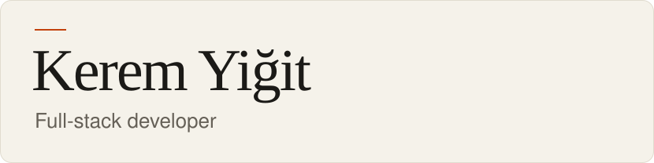

<picture>
  <source media="(prefers-color-scheme: dark)" srcset="./assets/header-dark.svg">
  
</picture>

I build storefronts, developer tooling and the occasional systems crate.
Self-taught, based in Türkiye, and looking for work with teams abroad.

TypeScript · Rust · PostgreSQL · Next.js · NestJS

## Selected work

[**aviary**](https://github.com/Ru1vly/aviary) 
SEO and GEO audits as an npm package.

[**ahenk**](https://github.com/Ru1vly/ahenk) 
Offline-first sync in Rust.

[**pedigree-lineage-service**](https://github.com/Ru1vly/pedigree-lineage-service) 
Event-driven lineage on Kafka with the outbox pattern.

---

[LinkedIn](https://linkedin.com/in/kerem-yigit) · [LeetCode](https://leetcode.com/u/Ru1vly/)
